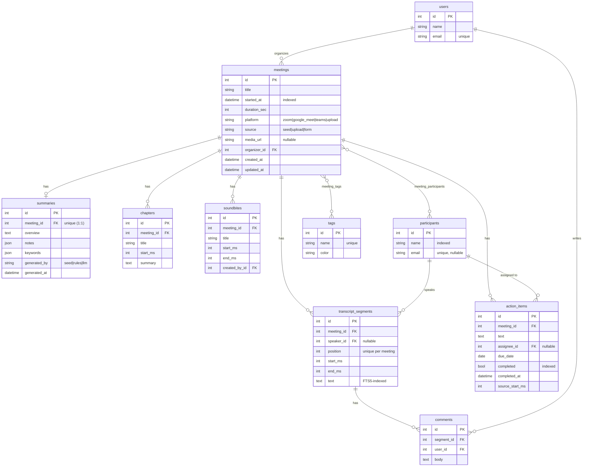

# Fireflies.ai Clone: Meeting Notes & Transcripts

A full-stack clone of the Fireflies.ai meeting workspace. You can browse a meeting library, open an interactive transcript that stays in sync with a player, read AI summaries, outlines and action items, search every transcript, and upload or paste new transcripts to get notes in seconds.

> **Live demo:** _add your Vercel URL here_ &nbsp;·&nbsp; **API docs:** _your Render URL_/docs

| | |
|---|---|
| **Frontend** | Next.js 15 (App Router) · TypeScript · Tailwind CSS v4 · SWR · lucide-react |
| **Backend** | Python 3.12 · FastAPI · SQLAlchemy 2.0 · Pydantic v2 |
| **Database** | SQLite, with an FTS5 full-text index for transcript search |
| **AI (optional)** | Claude through the Anthropic SDK. Without a key, a built-in rule-based summarizer is used |

---

## Features

### Core (required)
- **Meetings library**: meetings grouped by date with title, date, duration, platform, participants, tags and open action items.
  - Channels: *All Meetings*, *Uploads* and *Shared with me*.
  - A Fireflies-style **Filters** panel: date presets (Today, Last 7/14/30 days, custom), duration buckets, captured from, participants and tags, plus "Clear all filters".
  - Sort by recency, age, length or title, with pagination.
  - **Multi-select with bulk delete** (per row, per date group, or select all).
  - A per-meeting ⋯ menu: share, copy link, download, rename, delete.
  - Filters live in the URL, so a filtered view can be shared.
- **Meeting / transcript view**: a three-pane layout with a bottom player:
  - a **collapsible Smart Search rail** (AI filters, speakers, comments, soundbites)
  - the AI summary and notes
  - the transcript, with an **Edit mode** that saves corrected lines

  The header has AI Skills, Share and a ⋯ menu (copy link, regenerate notes, rename, download, delete).
  - Speaker-labelled, timestamped transcript. Clicking a line seeks the player to it, and during playback the current line is highlighted and auto-scrolled. Scrolling by hand pauses auto-scroll and shows a "Resume" button.
  - The seek bar doubles as a **speaker timeline**, with ticks for chapters. Controls include ±15 s and 0.75–2× speed.
  - **Transcript search** highlights every hit, shows "n of m", and steps between hits with Enter / Shift+Enter or the arrow buttons.
- **AI summary and notes**: a "General Summary" with a Copy button. It holds an overview, keywords (click one to find it in the transcript), bullet notes, and **action items grouped by owner** with jump-to timestamps. There is also an **outline** of timestamped chapters.
- **CRUD**: create a meeting by uploading a file, pasting a transcript or filling in a form; edit its title, date, participants and tags; delete it. Action items can be added, edited inline, reassigned, given due dates, completed and deleted. Everything persists in SQLite.
- **Fireflies-style UX**: sidebar navigation, a top bar with global search, modals, toasts, skeleton loaders, empty states and settings, with "Coming soon" placeholders for the live bot, integrations, analytics and team.

### Bonus (all implemented)
- **Comments** on transcript lines and **soundbites** (clips) created from any line
- **Export** to Markdown or TXT, and to PDF through a print-optimized layout
- **Global search** across all transcripts (FTS5, bm25-ranked, with highlighted snippets and deep links to the exact moment via `?t=ms`)
- **Tags** with filtering
- **"Ask AI" chat** about a meeting, with answers that cite transcript moments
- **Dark mode**, with no flash on load
- Also: **smart filters** (questions, tasks, metrics, dates), **talk-time analytics** per speaker, a cross-meeting **Action items** page, and a **Home** dashboard.

---

## Quick start

Prerequisites: Python 3.11+ and Node 20+.

```bash
# 1. Backend  (http://localhost:8000, Swagger UI at /docs)
cd backend
python -m venv .venv
source .venv/bin/activate          # Windows: .venv\Scripts\activate
pip install -r requirements-dev.txt
uvicorn app.main:app --reload
```

```bash
# 2. Frontend  (http://localhost:3000)
cd frontend
npm install
cp .env.example .env.local         # NEXT_PUBLIC_API_URL=http://localhost:8000
npm run dev
```

The database is created and seeded with 8 realistic meetings on first start. To reset it:

```bash
cd backend && python -m app.seed.loader --reset
```

Run the backend tests (parsers, CRUD, search, upload, ask, export):

```bash
cd backend && pytest -q
```

Sample files for trying the upload flow are in [`samples/`](samples/): `customer-call.vtt` and `standup.txt`.

### Optional: real LLM notes
Set `ANTHROPIC_API_KEY` in `backend/.env`. Summaries for new uploads, **Regenerate**, and **Ask AI** then use Claude (`claude-opus-5-5` by default; override with `ANTHROPIC_MODEL`). Any LLM failure falls back to the rule-based engine, so the app never breaks.

---

## Architecture

```
┌──────────────────────── Next.js (Vercel) ────────────────────────┐
│ app/            routes: /, /meetings, /meetings/[id], /tasks,     │
│                 /search, /uploads, /settings, placeholders        │
│ components/     layout/ · meetings/ · meeting/ · action-items/ ·  │
│                 ui/ (Button, Modal, Avatar, ChipsInput...) ·       │
│                 providers/ (Theme, Toast)                         │
│ lib/            api.ts (typed client) · types.ts · format.ts ·    │
│                 useMediaClock.ts (player clock) · hooks.ts        │
└───────────────▲──────────────────────────────────────────────────┘
                │ JSON over HTTPS (SWR cache + revalidation)
┌───────────────┴──────────── FastAPI (Render) ────────────────────┐
│ routers/        meetings.py (meeting + sub-resources)             │
│                 resources.py (action items, segments, comments,   │
│                 soundbites, tags, participants, search, me)       │
│ services/       meetings.py   - domain logic, queries, ingestion  │
│                 transcript_parser.py - txt / vtt / srt / json     │
│                 summarizer.py - rules engine | Claude             │
│                 qa.py         - Ask AI (retrieval | Claude)       │
│                 search.py     - FTS5 + bm25 + snippets            │
│                 exporter.py   - Markdown / TXT                    │
│                 llm.py        - Anthropic SDK wrapper (optional)  │
│ models.py · schemas.py · database.py · seed/                      │
└───────────────▲──────────────────────────────────────────────────┘
                │ SQLAlchemy 2.0
          SQLite (+ segments_fts virtual table, kept in sync by triggers)
```

**Key design decisions**
- **Thin routers, fat services.** Routers validate and map HTTP; all business rules (participant resolution, speaker mapping, summary generation, list queries) live in `services/` and can be unit-tested without HTTP.
- **Pluggable AI.** `summarizer.generate_notes()` and `qa.answer_question()` return the same types whether they come from the deterministic rules engine or from Claude. `generated_by` on the summary records which one ran.
- **One player clock.** `useMediaClock` exposes `currentMs / seek / play / rate`. It drives a real `<audio>` element when a meeting has `media_url`, and otherwise simulates playback, so transcript sync works the same either way. The active line is derived from `currentMs`; nothing is duplicated.
- **Search in the database, not in Python.** An external-content FTS5 table indexes `transcript_segments.text` with the porter stemmer ("churned" matches "churn"). INSERT/UPDATE/DELETE triggers keep it in sync, so application code never writes to it.
- **Server data in SWR, UI state local.** Mutations call the typed `api` client, then revalidate the affected keys (`useInvalidate`). Filters live in the URL.

---

## Database schema



**Why it's shaped this way**
- **`participants` are separate from `users`.** Most people in a meeting never sign in to the app. A participant's identity is the email when known and the name otherwise, so uploaded speakers ("Jane") and seeded attendees resolve to one row and appear in filters across meetings.
- **Segments reference a speaker by FK**, not a copied name, so one person is one row across all meetings (participant filter, assignee pickers), and talk-time stats come from a simple aggregation. `position` gives a stable order (unique per meeting), and `(meeting_id, start_ms)` is indexed for time lookups.
- **Times are integer milliseconds** to avoid float drift when comparing playhead and segment boundaries.
- **Summary is 1:1 with meeting** (a unique FK). `notes` and `keywords` are ordered lists that are only ever read whole, so they're JSON columns rather than two extra tables. Chapters and action items *are* queried and edited individually, so they get their own tables.
- **Action items** keep `source_start_ms` (jump to where the task was said), a nullable assignee (`ON DELETE SET NULL`), and `completed_at` for history. `completed` is indexed for the cross-meeting task list.
- **Integrity**: `PRAGMA foreign_keys=ON` with `ON DELETE CASCADE` from meetings to their children, plus ORM-level `delete-orphan`. Deleting a meeting removes its segments (and, through triggers, their FTS rows), summary, chapters, action items, soundbites and comments.

---

## API overview

Interactive docs are at **`/docs`** (Swagger) and `/redoc`. All routes are under `/api`.

| Method | Path | Description |
|---|---|---|
| GET | `/meetings` | List. Query: `q`, `participant_id`, `tag`, `date_from`, `date_to`, `source`, `platform`, `min_minutes`, `max_minutes`, `sort` (`recent`/`oldest`/`longest`/`title`), `page`, `page_size` |
| POST | `/meetings/bulk-delete` | `{ids: [...]}` → `{deleted}` (library multi-select) |
| POST | `/meetings` | Create from JSON (`title`, `started_at`, `participants[]`, `tags[]`, optional `transcript_text`, `transcript_format`) |
| POST | `/meetings/upload` | Create from a multipart file (`.txt` `.vtt` `.srt` `.json`, max 2 MB) |
| GET | `/meetings/{id}` | Full detail: segments + comments, summary, chapters, action items, soundbites, speaker stats |
| PATCH | `/meetings/{id}` | Update title, date, participants or tags (partial) |
| DELETE | `/meetings/{id}` | Delete (cascades) |
| POST | `/meetings/{id}/summary/regenerate` | Rebuild summary + outline (keeps user-edited action items) |
| POST | `/meetings/{id}/ask` | `{question}` → `{answer, citations[], generated_by}` |
| GET | `/meetings/{id}/export?format=md\|txt` | Download notes + transcript |
| POST | `/meetings/{id}/action-items` | Add an action item |
| PATCH / DELETE | `/action-items/{id}` | Edit, complete or reassign (partial: `{"assignee_id": null}` clears) / delete |
| GET | `/action-items` | Cross-meeting tasks. Query: `completed`, `assignee_id` |
| POST | `/meetings/{id}/soundbites` · DELETE `/soundbites/{id}` | Clips |
| PATCH | `/segments/{id}` | Correct a transcript line (FTS stays in sync) |
| POST | `/segments/{id}/comments` · DELETE `/comments/{id}` | Comments |
| GET | `/search?q=` | Global search across titles and transcripts, with highlighted snippets |
| GET | `/participants`, `/tags`, `/me`, `/health` | Lookups |

Errors use FastAPI's standard shape (`{"detail": ...}`) with appropriate status codes: 404 not found, 413 file too large, 422 validation or unparseable transcript, 409 duplicate tag.

---

## Transcript formats

| Format | Example |
|---|---|
| `.txt` | `[00:01:05] Jane Doe: Let's start.` (also `00:01:05 Jane:`, `Jane (01:05):`, or plain `Jane: ...`. Lines without a speaker continue the previous line, and missing timestamps are estimated from speaking rate) |
| `.vtt` | WebVTT cues with `<v Jane Doe>` voice tags or `Jane: ` prefixes |
| `.srt` | SubRip cues with `Jane: ` prefixes |
| `.json` | `[{"speaker": "Jane", "start": 65.0, "end": 70.2, "text": "..."}]` or `{"segments": [...]}` (`start_ms` is accepted too) |

Speakers not in the participant list are created and added to the meeting automatically.

---

## Deployment

**Backend → Render** (the [`render.yaml`](render.yaml) blueprint is included)
1. Render → *New* → *Blueprint* → select the repo.
2. Set `CORS_ORIGINS` to the Vercel URL. Optionally set `ANTHROPIC_API_KEY`.
3. The free tier's disk is ephemeral. The database reseeds on every boot, which suits a demo. For durable data, attach a Render disk and point `DATABASE_URL` at it.

**Frontend → Vercel**
1. Import the repo and set **Root Directory** to `frontend`.
2. Add the env var `NEXT_PUBLIC_API_URL=https://<your-render-service>.onrender.com`.
3. Deploy. `*.vercel.app` preview URLs are already allowed by the API's CORS regex.

---

## Assumptions & scope

- **No real authentication.** Every request acts as the default workspace user (Alex Rivera), per the brief.
- **No speech-to-text or live bot.** Transcripts are seeded, uploaded or pasted. Seeded meetings have no audio file, so the player simulates playback against transcript timestamps; a meeting with a `media_url` plays real audio through the same controls.
- **AI notes** for seeded meetings are pre-written. New meetings get notes from the rule-based summarizer (keyword frequency, sentence scoring, commitment-phrase detection for tasks), or from Claude when a key is configured.
- **Regenerating** a summary rewrites the overview, notes, keywords and outline, but never overwrites action items you've edited or completed.
- Integrations, team sharing, analytics and notetaker settings are "Coming soon" placeholders.
- The seed data (company "Northwind Labs", its people and conversations) is fictional and was written for this project.
- The UI follows Fireflies' layout and interaction patterns but uses an original logo and its own components, written from scratch; no Fireflies assets are used.

## Project structure

```
backend/
  app/
    main.py  config.py  database.py  models.py  schemas.py
    routers/   meetings.py  resources.py
    services/  meetings.py  transcript_parser.py  summarizer.py  qa.py  search.py  exporter.py  llm.py
    seed/      loader.py  meetings/*.json
  tests/       test_api.py  test_parser.py
frontend/
  src/app/         page.tsx  meetings/  meetings/[id]/  tasks/  search/  uploads/  settings/ ...
  src/components/  layout/  meetings/  meeting/  action-items/  ui/  providers/
  src/lib/         api.ts  types.ts  format.ts  hooks.ts  useMediaClock.ts
samples/           customer-call.vtt  standup.txt
render.yaml
```
